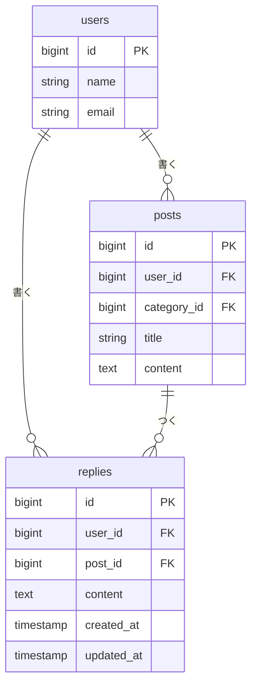

> この設計書は、この機能を実装した時点の記録です。このあとは更新していません。

# リプライ機能 設計

Issue: #1「ポストにリプライ機能を追加する」

## 概要

今は、ポストを読むだけで返す手段がない。ポストを読んだ人がその場で一言返せるように、ポストへのリプライ機能を足す。

- ポスト1件の詳細画面を追加し、ポストとそのリプライを一覧で見られるようにする
- 詳細画面から本文を入れてリプライを送れる
- 自分のリプライだけ削除できる。判定は `PostPolicy` と同じやり方に揃える
- リプライはポストに対してだけ付ける。リプライへのリプライ（入れ子）と、リプライの編集は作らない
- 本文は必須で140字まで。上限はポストと同じ `Post::CONTENT_MAX_LENGTH` を使う
- 詳細画面のリプライは新しい順に並べる
- ポストを削除したら、そのリプライも一緒に消える

## 受け入れ条件

Issue の「完成の条件」をそのまま使う。

- [ ] ポストを1件開くと、そのポストとリプライの一覧が見える
- [ ] 本文を入れてリプライを送ると、一覧に増える
- [ ] 本文が空のままだと、エラーが表示されてリプライは増えない
- [ ] 自分のリプライは消せて、他人のリプライは消せない
- [ ] タイムラインの一覧・編集・削除が今までどおり動く

## 変えないもの

- タイムライン（`posts.index`）の一覧・編集・削除の動き
- ポストの編集画面の入力チェックとメッセージ
- `PostPolicy` の中身（リプライ用に `ReplyPolicy` を別に作り、判定の書き方だけ揃える）
- `posts` テーブルの列
- タイムラインの見た目で変わるのは、各ポストに「返信」リンクを1つ足すところだけ

## 増えるテーブル

`replies` テーブルを1つ足す。

| 列         | 型                | 制約                                   | 説明                     |
| :--------- | :---------------- | :------------------------------------- | :----------------------- |
| id         | bigint unsigned   | 主キー                                 | -                        |
| user_id    | bigint unsigned   | 外部キー（users.id）、削除時に連動削除 | リプライを書いた人       |
| post_id    | bigint unsigned   | 外部キー（posts.id）、削除時に連動削除 | リプライ先のポスト       |
| content    | text              | NOT NULL                               | 本文（140字まで）        |
| created_at | timestamp         | NULL可                                 | 作成日時（並び順に使う） |
| updated_at | timestamp         | NULL可                                 | 更新日時                 |

- 本文の140字は、`content` 列の型ではなく入力チェックで守る（`posts.content` と同じ）
- ポストやユーザーを消したときにリプライだけが残らないよう、`posts` と同じく連動削除にする

## 増える画面

| 画面                 | 場所                       | 見える人     | 内容                                                                                   |
| :------------------- | :------------------------- | :----------- | :------------------------------------------------------------------------------------- |
| ポスト詳細画面       | `GET /posts/{post}`        | ログインした人 | ポスト1件、リプライ一覧（新しい順）、リプライ投稿フォーム                            |

あわせて、次の操作が増える。

| 操作           | 場所                           | 画面での置き場所                                   | 終わったあと         |
| :------------- | :----------------------------- | :------------------------------------------------- | :------------------- |
| リプライを送る | `POST /posts/{post}/replies`   | 詳細画面のフォーム                                 | 詳細画面に戻る       |
| リプライを消す | `DELETE /replies/{reply}`      | 詳細画面の各リプライ（自分のものだけに「削除」）   | 消したリプライの元のポストの詳細画面に戻る |
| 詳細画面へ行く | `GET /posts/{post}`            | タイムラインの各ポストの「返信」リンク             | -                    |

- 3つのルートはすべて、認証が必要なグループ（`auth` ミドルウェア）の中に置く
- 「削除」ボタンは `@can('delete', $reply)` で出し分ける。画面で隠すだけにせず、コントローラーでも `authorize` する

## 入力チェックとメッセージ一覧

### 入力チェック表（リプライ投稿フォーム）

| 画面           | 項目 | 必須 | 文字数・桁数 | 形式・値の範囲 | ほかの項目との関係 |
| :------------- | :--- | :--- | :----------- | :------------- | :----------------- |
| ポスト詳細画面 | 本文 | 必須 | 140字以内    | -              | -                  |

- 改行は、ブラウザが CRLF で送るので、LF にそろえて1文字として数える（ポストの更新と同じ）
- リプライ先のポストは URL の `{post}` で決まる。存在しないポストなら 404 になるので、入力チェックの項目には含めない

### メッセージ一覧

| 場面                     | 項目 | 条件                 | メッセージ                           | 表示場所                 |
| :----------------------- | :--- | :------------------- | :----------------------------------- | :----------------------- |
| リプライを送る           | 本文 | 空                   | 本文を入力してください。             | 本文欄の下（赤字）       |
| リプライを送る           | 本文 | 140字を超えている    | 本文は140字以内で入力してください。  | 本文欄の下（赤字）       |
| リプライを消す           | -    | 他人のリプライ       | （画面なし。403 を返す）             | -                        |
| どの操作も               | -    | ログインしていない   | （ログイン画面へ移動する）           | -                        |

- 本文のメッセージの書き方は、ポスト編集画面（`content.required` / `content.max`）に合わせる
- 入力チェックに引っかかったら、リプライは増やさず、入力した内容を本文欄に残す

## テスト観点

Feature テストで確認する。`tests/Feature/PostContentLimitTest.php` と同じ書き方に揃える。

### 見る

- ログインしていないと、詳細画面が開けない（ログイン画面へ移動する）
- 詳細画面に、ポストの内容とそのポストのリプライが出る
- 別のポストのリプライは出ない
- リプライは新しい順に並ぶ
- リプライが1件もないときも、詳細画面が開ける
- 存在しないポストの詳細画面は 404 になる

### 送る

- 本文を入れて送ると、`replies` に1件増え、詳細画面に戻る。`user_id` はログイン中の人、`post_id` は対象のポストになる
- 本文が空だとエラーが出て、リプライは増えない
- 本文がちょうど140字なら送れる
- 本文が141字だとエラーが出て、リプライは増えない
- 改行を含む本文は、CRLF を LF にそろえて数える（改行を含めて140字ちょうどなら送れる）
- ログインしていないと送れず、リプライは増えない

### 消す

- 自分のリプライは消せて、消したあとはそのポストの詳細画面に戻る
- 他人のリプライは 403 になり、消えない
- ログインしていないと消せない
- 詳細画面で、自分のリプライだけに「削除」ボタンが出る
- ポストを削除すると、そのポストのリプライも消える

### 変わっていない

- タイムラインに各ポストの「返信」リンクが出て、詳細画面へ行ける
- タイムラインの一覧・編集・削除、本文140字の入力チェックが今までどおり動く（既存のテストが通る）
